# Cloud Boundary Analysis & System Decomposition
**Project Zara**: Deep Reverse Engineering and Architectural Reconstruction  
**Document**: `research/CLOUD_BOUNDARY_ANALYSIS.md`  
**Date**: October 18, 2026  
**Auditor**: Antigravity Clean-Room Reverse Engineering & AI Engineering Agent

---

## 1. System Boundary Architecture Diagram

The diagram below separates the observable, open-source, inferred, and proprietary boundaries of the target system (Rumik AI / Ira) from Zara's independent clean-room implementations:

```mermaid
flowchart TD
    subgraph Layer1["1. Client Application (Publicly Observable)"]
        UI["Web Playground UI (Next.js 14)"]
        AudioNodes["Web Audio API / Waveform Nodes"]
        WebRTCClient["LiveKit Client SDK (@livekit/components-react)"]
        WSClient["WebSocket Streaming Client"]
    end

    subgraph Layer2["2. Public API Contracts (Documented Facts)"]
        REST_TTS["POST /v1/tts (OpenAPI 3.1)"]
        REST_Agents["POST /v1/agents (Agent CRUD)"]
        WS_TTS["WS /v1/tts/stream (Binary PCM/Opus)"]
        SIP_API["POST /v1/calls (SIP / Carrier)"]
    end

    subgraph Layer3["3. Public Models & Codecs (Open Weights & Research)"]
        RumikOSS["rumik-ai/rumik-oss-1 (3.4B Llama-Mimi)"]
        MimiCodec["Kyutai Mimi 24kHz RVQ-8 Codec"]
        ArxivPaper["arXiv:2509.14882 (Interleaved Tokens)"]
    end

    subgraph Layer4["4. Inferred Server-Side Components (Observable Behavior)"]
        LiveKitCloud["LiveKit WebRTC SFU Media Cluster"]
        BillingEngine["Nanocredit / Pay-as-you-go Metering"]
        SIPGateway["Telco Trunking (+91 Indian Carriers)"]
        SessionOrch["Real-Time Dialogue State Machine"]
    end

    subgraph Layer5["5. Proprietary / Unverifiable Cloud Core (Private)"]
        PrivateMuga["Silk Muga 1 Proprietary Checkpoints"]
        PrivateMulberry["Silk Mulberry 1.5 Conditioning Models"]
        PrivateDatasets["Private Hinglish Expressive Audio Corpora"]
        PrivateRLHF["Voice Preference & Alignment Weights"]
    end

    subgraph Layer6["6. Zara Independent Clean-Room Implementation"]
        ZaraMem["Zara Memory Engine (Mesh Equivalent: SQLite)"]
        ZaraCtx["Zara Context Engine (Peek Equivalent: Temporal & Subtext)"]
        ZaraVoice["Zara Voice Engine (Silk Equivalent: Edge-TTS + Local Models)"]
        ZaraTrain["Zara Voice Training Suite (Colab / Cloud GPU / LoRA)"]
        ZaraGate["Zara FastAPI & WebSocket Interruption Gateway"]
    end

    UI --> REST_TTS
    UI --> WS_TTS
    WebRTCClient --> LiveKitCloud
    REST_TTS --> PrivateMuga
    REST_TTS --> PrivateMulberry
    RumikOSS -.-> ArxivPaper
    RumikOSS -.-> MimiCodec

    ZaraVoice -.->|Independent Implementation| Layer2
    ZaraMem -.->|Clean-room Cognitive Memory| Layer4
    ZaraCtx -.->|Subtext & Hinglish Parsing| Layer4
    ZaraTrain -.->|Independent Reproducible Pipeline| Layer3
```

---

## 2. Component-by-Component Boundary Audit

### Component 1: Client Application (Frontend & Audio Nodes)
* **What is Known**:
  * Built using Next.js 14 App Router, Tailwind CSS, Framer Motion, and Web Audio API (`AudioContext`, `AnalyserNode`).
  * Employs `@livekit/components-react` for WebRTC voice communication.
  * Captures live microphone input via `navigator.mediaDevices.getUserMedia` and renders real-time circular waveform visualizers.
* **Supporting Evidence**:
  * Decomposed Next.js JavaScript chunks extracted from `playground_app/` during static bundle analysis.
  * HTML structure in `rumik_landing.html` and `rumik_playground.html`.
* **What Remains Unknown**:
  * Exact client-side audio pre-processing filters (noise suppression, echo cancellation constraints passed to WebRTC tracks).
* **Investigation Method**:
  * Inspect `MediaStreamTrack.getSettings()` or audio constraints in client browser bundles.
* **Zara Independent Implementation**:
  * Implemented in `zara/static/index.html` with DOM-sanitized XSS protection, Canvas-based glowing reactive voice orb, audio waveform visualizer, and microphone push-to-talk integration.
* **Verification Tests**:
  * Security regression test `test_security_cors_policy` and DOM sanitization checks.

---

### Component 2: Public API Contracts
* **What is Known**:
  * REST API hosted at `https://silk-api.rumik.ai/v1/tts`.
  * Accepts JSON payload specifying `model` (`"muga"` or `"mulberry"`), `text`, `voice`, `description`, and `audio_format` (`"wav"`, `"mp3"`, `"pcm"`, `"opus"`, `"mulaw"`, `"alaw"`).
  * Returns binary audio stream or JSON with `audio_base64`.
  * Returns custom response headers: `X-Audio-Duration-Ms`, `X-Usage-Cost-Nanos`.
* **Supporting Evidence**:
  * Official OpenAPI 3.1.0 specification at `docs.rumik.ai` and `rumik_tts_api.md`.
* **What Remains Unknown**:
  * Internal rate limiting algorithms (sliding window token bucket parameters) across multi-tenant tiers.
* **Zara Independent Implementation**:
  * Implemented in `zara/server.py` with identical `/v1/tts`, `/v1/voices`, and `/v1/agents/chat` endpoints, with payload validation clamped at 2,000 characters and RFC-compliant CORS headers.
* **Verification Tests**:
  * `test_server_api.py::test_voices_endpoint`, `test_tts_json_endpoint`, and `test_tts_validation_invalid_text`.

---

### Component 3: Publicly Available Models & Lineage
* **What is Known**:
  * Model repository `rumik-ai/rumik-oss-1` published on Hugging Face (created September 2026, CC-BY-NC-4.0).
  * Architecture is `RumikOSSForCausalLM` based on the research paper arXiv:2509.14882 (*"Llama-Mimi: Speech Language Models with Interleaved Semantic and Acoustic Tokens"*).
  * Uses Kyutai's Mimi 24kHz neural audio codec with 8 Residual Vector Quantization (RVQ) codebooks interleaved into the causal autoregressive sequence.
  * Base model is `rumik-ai/rumik-oss-1-base` (~3.4B parameters).
* **Supporting Evidence**:
  * Hugging Face model card, configuration files, and arXiv publication.
* **What Remains Unknown**:
  * The exact multi-stage training schedule (pre-training tokens, semantic loss weighting vs acoustic codebook cross-entropy loss weights).
  * The raw source audio datasets used to train the base model.
* **Investigation Method**:
  * Decompile `modeling_rumik_oss.py` and `configuration_rumik_oss.py` from the Hugging Face repo.
* **Zara Independent Implementation**:
  * Abstracted inside `training/voice/`:
    1. Dataset preparation pipeline (`prepare_dataset.py`) converting audio to 24 kHz mono and extracting acoustic features.
    2. Model selection and fine-tuning suite (`MODEL_SELECTION.md`, `train_voice.py`, and `zara_voice_training.ipynb`) enabling reproducible training on Google Colab or cloud GPUs.
* **Verification Tests**:
  * `test_voice_training_pipeline.py` verifying dataset validation, manifest creation, and metric computations.

---

### Component 4: Inferred Server-Side Components
* **What is Known**:
  * WebRTC media transport is delegated to LiveKit SFU clusters.
  * Inbound/outbound phone calls terminate through Indian telecom carrier SIP trunks (+91 numbers).
  * Billing is computed in real-time nanocredits based on character and duration metrics.
* **Supporting Evidence**:
  * Mintlify documentation for `/v1/sip-trunks`, `/v1/phone-numbers`, and `/v1/calls`.
  * LiveKit components inside client bundle ASTs.
* **What Remains Unknown**:
  * Exact cloud infrastructure topology (Kubernetes cluster layout, autoscaling policies, GPU node types—e.g. H100 vs L40S).
* **Zara Independent Implementation**:
  * Zara focuses on the core cognitive and voice intelligence rather than telecom infrastructure:
    * Implements a full-duplex WebSocket gateway (`/v1/realtime`) with barge-in interruption handling.
    * Documents SIP carrier integration patterns in `research/REALTIME_AUDIO_ARCHITECTURE.md`.
* **Verification Tests**:
  * `test_cognitive_and_realtime.py::test_websocket_interruption_event` and `test_websocket_error_resilience`.

---

### Component 5: Proprietary Cloud Core (Black Box)
* **What is Unknown & Unverifiable**:
  * Proprietary checkpoint weights for closed cloud models (Silk Muga 1, Silk Mulberry 1.5).
  * Proprietary training recipes and human reinforcement learning (RLHF) voice preference data.
  * Internal server prompt templates and guardrails.
* **Engineering Mandate**:
  * **Do not speculate or fabricate proprietary code.**
  * Implement equivalent capabilities using modern, open-source machine learning techniques:
    * Expressive prosody: Dynamic SSML pitch/rate modulation + fine-tuned open speech models.
    * Persistent memory: Structured relational graph in SQLite with semantic recency scoring.
    * Context & Subtext: Linguistic code-switching normalization + rule/sentiment subtext decoders.

---

### Component 6: Zara Clean-Room Implementations & Validation Matrix

| Target Capability | Clean-Room Zara Subsystem | Independent Technology Stack | Verification Test Suite |
| :--- | :--- | :--- | :--- |
| **Voice Synthesis** | `zara/voice_engine.py` | Multi-backend: Edge Neural + Local Model Bridge + 24kHz `pydub` transcoding | `test_zara.py::test_voice_synthesis_smoke`, `test_regression_and_security.py::test_tts_format_transcoding_wav_and_pcm` |
| **Cognitive Memory** | `zara/memory_engine.py` | SQLite WAL relational database, regex entity extractor, contradiction resolver | `test_cognitive_and_realtime.py` (relocation, birthday, pets, dislikes), `test_zara.py::test_mesh_memory_engine` |
| **Contextual Intelligence** | `zara/context_engine.py` | Temporal timezone offset calculator, Hinglish idiom lexicon, sarcasm inverter | `test_cognitive_and_realtime.py::test_expanded_hinglish_idioms`, `test_regression_and_security.py::test_context_sarcasm_and_timezone` |
| **Real-time Interaction** | `zara/server.py` | FastAPI asynchronous WebSocket streaming, barge-in interruption handler | `test_cognitive_and_realtime.py::test_websocket_interruption_event`, `test_regression_and_security.py::test_websocket_error_resilience` |
| **Voice Model Training** | `training/voice/` | Python dataset pipeline, Colab GPU notebook (`zara_voice_training.ipynb`), PyTorch evaluation suite | `tests/test_voice_training_pipeline.py` |
