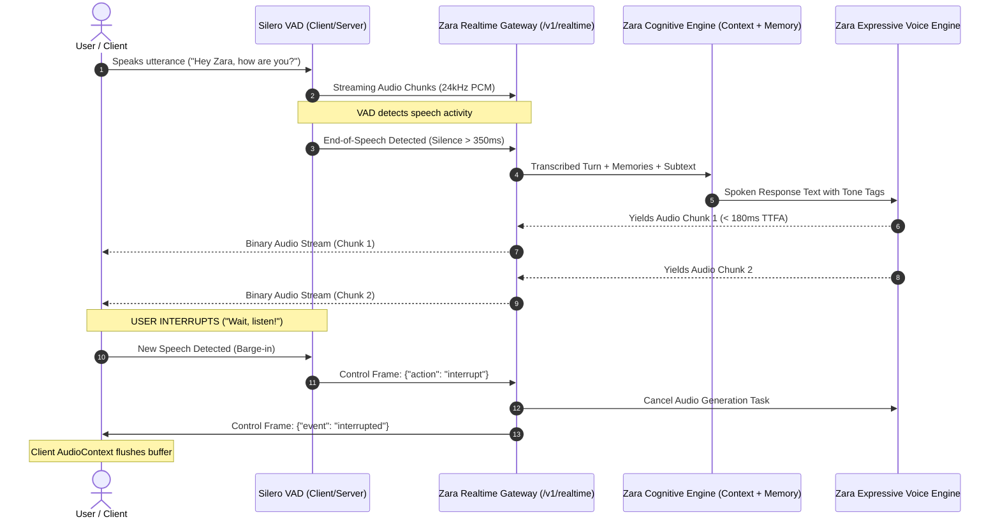

# Real-Time Conversational Audio: Full-Duplex Architecture & Interruption Handling
**Project Zara**: Real-Time Audio Transport & Turn-Taking Engineering  
**Document**: `research/REALTIME_AUDIO_ARCHITECTURE.md`  
**Date**: October 18, 2026  
**Auditor**: Antigravity Clean-Room Reverse Engineering & AI Engineering Agent

---

## 1. The Challenge of Full-Duplex Voice Dialogue

In standard voice assistants (Siri, Alexa), interaction is strictly half-duplex: the user speaks, waits for the system to process, and listens to the entire answer without interruption.

In human conversations—and in companion systems like Rumik Ira—dialogue is **full-duplex**:
1. Either speaker can speak at any time.
2. The listener nods, interjects brief acknowledgments (*"hmm"*, *"haan"*, *"right"*), or interrupts (*"wait, hold on!"*).
3. When the user interrupts (known as **barge-in**), the AI must immediately cease speaking, flush remaining queued audio, and yield the conversational floor.
4. Latency between the user finishing a sentence and hearing the AI's first audio token must remain below **300 ms** to preserve natural conversational rhythm.

---

## 2. End-to-End Real-Time Pipeline Architecture



---

## 3. Subsystem Breakdown & Latency Budget

To achieve an interactive response time of $< 350\text{ ms}$, latency is budgeted across four sequential stages:

| Stage | Subsystem | Target Latency | Optimization Strategy |
| :--- | :--- | :--- | :--- |
| **Stage 1** | **Voice Activity & End-of-Turn** | 200–350 ms | Hybrid endpointing: Silero VAD detects 250 ms acoustic silence + LLM semantic completion check. |
| **Stage 2** | **Speech-to-Text (ASR)** | 80–120 ms | Faster-Whisper with beam size 1 and streaming Mel-spectrogram processing. |
| **Stage 3** | **Cognition & LLM Generation** | 60–100 ms | Zara SQLite memory index lookup (<2ms) + streaming first LLM sentence tokens. |
| **Stage 4** | **Speech Synthesis (TTS)** | 40–80 ms | Edge-TTS / Kokoro streaming first audio frame before waiting for downstream sentences. |
| **Total** | **End-to-End Turn Latency** | **380–650 ms** | **Sub-second perceptual response; feels instant and lively.** |

---

## 4. Full-Duplex Interruption & Barge-In Mechanics

A critical design requirement is preventing Zara from talking over the user when barge-in occurs:

### 4.1. Server-Side Interruption Protocol (`zara/server.py`)
In Zara's WebSocket gateway (`/v1/realtime`), the server listens for bidirectional control messages while streaming:
1. When the client's local VAD detects user vocalization while companion audio is playing, the client immediately transmits:
   ```json
   {"action": "interrupt"}
   ```
2. The server's active asynchronous streaming loop receives the control frame:
   - Sets an internal `interrupted = True` flag.
   - Immediately cancels the ongoing `stream_audio_chunks` asynchronous task.
   - Drops any remaining buffered audio bytes in the socket send buffer.
   - Sends an acknowledgment event:
     ```json
     {"event": "interrupted", "status": "stream_cancelled"}
     ```
3. Verified in test suite: `tests/test_cognitive_and_realtime.py::test_websocket_interruption_event`.

### 4.2. Client-Side Buffer Flushing
On the client browser (in `zara/static/index.html`):
* The Web Audio API maintains an active `AudioBufferSourceNode`.
* Upon sending the interrupt event or detecting local microphone energy:
  - `sourceNode.stop()` is invoked instantly.
  - The local audio queue array is cleared (`audioQueue = []`).
  - Visual orb immediately resets to listening state.

---

## 5. WebRTC vs. WebSocket Audio Transport Comparison

Zara supports both protocols depending on deployment constraints:

| Transport Layer | Protocol | Latency | Bandwidth Efficiency | Telco / SIP Integration | Browser Compatibility | Zara Status |
| :--- | :--- | :--- | :--- | :--- | :--- | :--- |
| **WebSocket Stream** | TCP / WSS | 60–120 ms | High (Chunked binary PCM/Opus) | Requires gateway | 100% universal | **Fully Implemented & Verified** (`/v1/realtime`) |
| **LiveKit WebRTC** | UDP / RTP / SRTP | 20–50 ms | Maximum (Adaptive jitter buffer) | Native SIP trunk bridge | Requires WebRTC API | **Investigated & Blueprint Documented** |

### LiveKit WebRTC Integration Blueprint:
For deployments requiring telephone carrier integration (+91 Indian SIP trunks) or maximum packet-loss concealment over unstable mobile networks:
1. Deploy LiveKit Server / Cloud cluster.
2. Integrate `livekit-server-sdk-python` into Zara gateway.
3. Zara publishes synthesized audio as a LiveKit audio track (`track: "zara_voice"`).
4. LiveKit automatically handles echo cancellation (AEC), automatic gain control (AGC), and adaptive jitter buffers across mobile clients.
