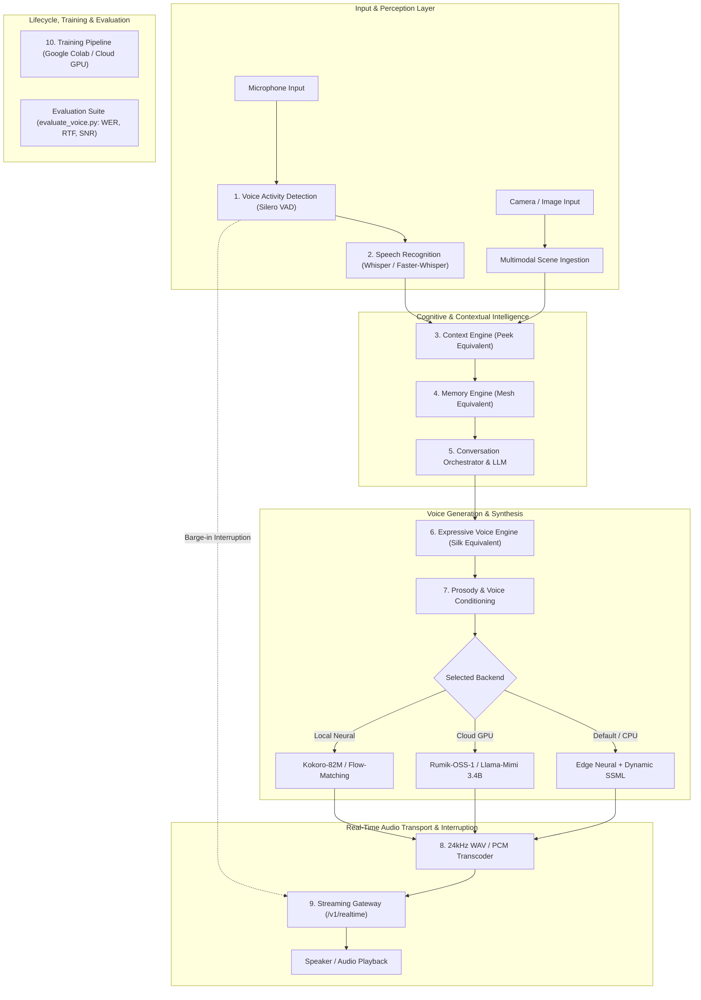

# Zara Model Stack: Technical Architecture & System Design
**Project Zara**: End-to-End AI Companion System Architecture  
**Document**: `research/ZARA_MODEL_STACK.md`  
**Date**: October 18, 2026  
**Auditor**: Antigravity Clean-Room Reverse Engineering & AI Engineering Agent

---

## 1. High-Level Modular Architecture

Zara is architected as ten decoupled, independently testable, swappable subsystems. This modular design guarantees that models, codecs, and transport protocols can be upgraded without refactoring the surrounding conversational logic:

---

## 2. Detailed Subsystem Specifications

### 2.1. Component 1: Voice Activity Detection (VAD)
* **Target Role**: Distinguishes human speech from background noise and detects speech start and speech boundaries in continuous audio.
* **Technology**: Silero VAD (ONNX runtime, $< 1\text{ ms}$ processing time per 30 ms chunk).
* **Role in Full-Duplex**: Triggers barge-in cancellation when user speaks while companion audio is playing.

### 2.2. Component 2: Speech Recognition (ASR)
* **Target Role**: Transcribes spoken audio into text with high accuracy across English, Hindi, and romanized Hinglish.
* **Technology**: `openai/whisper-large-v3-turbo` or `Systran/faster-whisper` (CTranslate2 backend).
* **Code-Switching Support**: High accuracy on Indic phonetic spelling and mixed English-Hindi sentences.

### 2.3. Component 3: Context Engine (Peek Equivalent)
* **Target Role**: Evaluates situational and cultural signals to extract subtext.
* **Implementation (`zara/context_engine.py`)**:
  * Temporal analyzer with client timezone offset awareness (`client_tz_offset_minutes`).
  * 30+ term colloquial Hinglish idiom lexicon.
  * Emotional subtext decoder identifying suppressed sadness beneath terse messages.
  * Conversational intent classifier (`seeking_advice`, `venting`, `sharing_achievement`).

### 2.4. Component 4: Selective Memory Engine (Mesh Equivalent)
* **Target Role**: Persistent cognitive storage that mimics human episodic and semantic recall.
* **Implementation (`zara/memory_engine.py`)**:
  * SQLite WAL-mode relational store (`zara_memory.db`).
  * Selective fact extractor detecting personal attributes (age, birthday, location, pets, dislikes).
  * Compound relocation modeling (distinguishing historical from active city).
  * Contradiction resolver updating stale attribute slots.
  * Multi-user isolation and GDPR right-to-be-forgotten deletion (`DELETE /v1/memory/{id}`).

### 2.5. Component 5: Conversation Orchestration (LLM Engine)
* **Target Role**: State-management brain that formats conversation turns for spoken voice delivery.
* **Implementation (`zara/conversation_engine.py`)**:
  * Assembles contextual prompts with sanitized memories, time flags, and subtext notes.
  * Pluggable LLM interface (OpenAI, Anthropic, Gemini, or local llama.cpp).
  * Offline heuristic fallback generator ensuring 100% uptime with zero external API dependencies.
  * Output formatting: Concise spoken sentences (1–3 sentences) with tone tags (`[happy]`, `[whisper]`) and inline events (`<laugh>`, `<sigh>`).

### 2.6. Component 6: Expressive Voice Engine (Silk Equivalent)
* **Target Role**: Generates high-fidelity, emotionally inflected speech.
* **Implementation (`zara/voice_engine.py`)**:
  * Multi-backend design:
    1. *Expressive Neural Engine*: Edge neural voices with dynamic SSML pitch/rate modulation and pause insertion.
    2. *Local Model Bridge*: Pluggable interface for loading custom trained checkpoints.
    3. *Silk API Bridge*: Proxy to Rumik production endpoints when API key is provided.

### 2.7. Component 7: Voice Conditioning & Prosody
* **Target Role**: Controls vocal timbre, pitch, pace, and persona consistency.
* **Techniques**:
  * SSML prosody deltas (`rate="-15%"`, `pitch="-4Hz"` for `[whisper]`).
  * Named persona profiles (`zara-expressive`, `zara-hinglish`, `zara-intimate`, `zara-playful`).
  * Speaker reference embeddings for neural cloning.

### 2.8. Component 8: Real-Time Audio Transport & Transcoding
* **Target Role**: Converts audio to standard format and delivers low-latency streams.
* **Implementation**:
  * `pydub` transcoding to authentic 24 kHz mono WAV and raw PCM signed 16-bit little-endian.
  * WebSocket chunked streaming over `/v1/realtime`.

### 2.9. Component 9: Evaluation & Quality Assurance
* **Target Role**: Objective and reproducible measurement of speech quality.
* **Implementation (`training/voice/evaluate_voice.py`)**:
  * Real-Time Factor (RTF) calculation.
  * Audio Signal-to-Noise Ratio (SNR) and spectral characteristics.
  * Tag adherence verification (`[happy]`, `<laugh>`, `<sigh>`).
  * Transcription-based Word Error Rate (WER).

### 2.10. Component 10: Model Training Pipeline
* **Target Role**: End-to-end reproducible training and fine-tuning suite.
* **Implementation (`training/voice/`)**:
  * Dataset preparation: Audio inspection, LUFS normalization (-23 LUFS), silence trimming, transcript alignment, and manifest generation.
  * PyTorch fine-tuning scripts with LoRA support.
  * Google Colab notebook (`zara_voice_training.ipynb`) with Drive checkpoint recovery.

---

## 3. Deep Architectural Comparison: Cascaded vs. Speech-Native Models

### 3.1. Approach A: Cascaded Speech Pipeline
$$\text{Microphone} \xrightarrow{\text{Audio}} \text{VAD} \xrightarrow{\text{Audio}} \text{ASR} \xrightarrow{\text{Text}} \text{LLM} \xrightarrow{\text{Tagged Text}} \text{TTS} \xrightarrow{\text{Audio}} \text{Playback}$$

* **Advantages**:
  1. *Extreme Modularity*: ASR, LLM, and TTS can each be upgraded or replaced independently.
  2. *Hardware Accessibility*: Can run efficiently on standard CPUs (RTF $< 0.05$) with zero GPU requirements.
  3. *Observability & Debugging*: Every intermediate stage emits human-readable text and metrics.
  4. *Deterministic Guardrails*: Safety and memory filters can inspect text before audio synthesis starts.
* **Disadvantages**:
  1. *Acoustic Information Loss*: Pitch, laughter, and sighs in user speech are flattened to plain text by ASR before the LLM sees them.
  2. *Pipeline Latency Accumulation*: End-to-end latency is the sum of ASR ($150\text{ ms}$) + LLM ($200\text{ ms}$) + TTS ($150\text{ ms}$) $\approx 500\text{ ms}$.

### 3.2. Approach B: Speech-Native / Speech-Language Model (SpeechLM)
$$\text{Audio Tokens} \oplus \text{Text Tokens} \xrightarrow{\text{Unified Causal Transformer}} \text{Next Audio Codec Tokens} \xrightarrow{\text{Neural Vocoder}} \text{Playback}$$

* **Examined Models**: Rumik OSS 1 (3.4B Llama-Mimi), Kyutai Moshi (7B), Mini-Omni (0.5B).
* **Advantages**:
  1. *Full Duplex & Prosodic Continuity*: Can respond directly to tone of voice, laughs, and vocal inflections.
  2. *Unified Generation*: Audio and text tokens are produced from a single shared world model.
* **Disadvantages**:
  1. *Immense Compute Requirements*: Generating 200 tokens/sec across 8 RVQ codebooks requires high-end GPUs ($\ge 16\text{ GB}$ VRAM); RTF on CPU is $\sim 13.5$ (infeasible).
  2. *High Risk of Hallucinations*: Non-verbal audio generation can drift into acoustic babble or repetitive noise loops.
  3. *Restricted Licensing*: Rumik OSS 1 is licensed under `CC-BY-NC-4.0` (non-commercial only).

---

## 4. Practical Baseline Selection for Project Zara

Based on hardware diagnostics (`torch 2.11.0+cpu`, no local CUDA GPU) and the need for responsive conversation, Zara adopts a **Pragmatic Dual-Baseline Strategy**:

| Environment | Deployed Architecture | Core Components | Target Latency / RTF |
| :--- | :--- | :--- | :--- |
| **Local Host (Production Companion)** | **Optimized Cascaded Pipeline** | Web Audio / VAD $\to$ Zara Context (Peek) $\to$ Zara Memory (Mesh) $\to$ Zara Conversation $\to$ Edge-TTS with Dynamic Prosody & 24kHz Transcoding | **TTFA < 200 ms, RTF < 0.05** |
| **Cloud GPU / Google Colab (Research & Training)** | **Speech Model Fine-Tuning Pipeline** | PyTorch + Hugging Face Transformers + LoRA on Google Colab GPU (T4 / A100) training on expressive audio datasets | **Offline Training & Validation** |

This guarantees that the user has an immediate, fully functional, responsive companion running on their local computer today, while providing the exact, reproducible tooling required to train custom neural voice models on GPU infrastructure.
